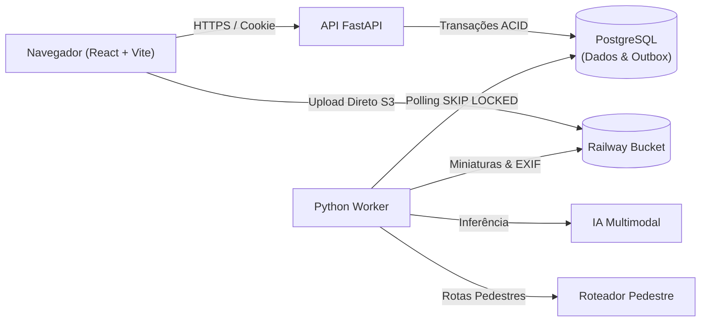

# Atlas Santos

Repositório oficial do sistema **Atlas Santos**, aplicação web de cartografia colaborativa desenvolvida para organizar, curar e disponibilizar fotografias, memórias, percursos reconstruídos e reflexões do Estudo do Meio em Santos (viagem realizada de 05 a 11 de outubro de 2026).

O acervo contempla **95 participantes** (83 estudantes e 12 servidores do IFSP Campus Araraquara), com organização em equipes, curadoria editorial pelos capitães e prazo improrrogável de entrega homologada em **04 de dezembro de 2026**.

---

## 1. Visão Geral e Escopo

O objetivo do sistema é preservar a memória pedagógica do Estudo do Meio através de uma interface cartográfica e de galeria com alta integridade documental:
- **Organização por Equipe**: Cada equipe gerencia seu próprio Atlas temático (relação 1:1, RN-01).
- **Cota de Contribuição**: Padrão de 20 fotografias por participante em cada atlas autorizado (capacidade de referência: 1.900 fotos).
- **Reconstrução Retrospectiva de Percursos**: Percursos pedestres inferidos pelas fotos e ajustados editorialmente pelo capitão, mantendo transparente a natureza estimada do trajeto (RN-11).
- **Descrições Assistidas por IA Multimodal**: Sugestões curtas geradas com base na imagem (sem metadados privados) e reflexão aprovada, sujeitas à curadoria humana obrigatória (RN-14).
- **Exportações**: Cadernos de memórias em formato A4 (PDF) e painéis resumo (PNG) com prioridade P1; formatos portáteis HTML e GeoJSON em prioridade P2.

### Fora de Escopo
- Rastreamento GPS ao vivo, gravação de rotas em tempo real ou importação GPX curva a curva.
- Rede social, curtidas, comentários públicos, ranqueamento ou reconhecimento facial.
- Sincronização contínua ou bidirecional com o IF-Arbitra (a integração é pontual via arquivo administrativo JSON).

---

## 2. Stack Tecnológica

| Camada | Tecnologia | Versão Fixada | Função no Sistema |
| :--- | :--- | :--- | :--- |
| **Backend API** | Python / FastAPI | `0.115.5` | Endpoints RESTful, contratos OpenAPI e validação Pydantic |
| **Persistência Relacional** | PostgreSQL | `16+` | Fonte única de verdade de estados, cotas e auditoria |
| **ORM & Migrações** | SQLAlchemy / Alembic | `2.0.36` / `1.14.0` | Mapeamento relacional e versionamento estrito de esquema |
| **Processamento Assíncrono**| Python Worker | Interno | Processo em segundo plano consumindo fila transacional `jobs` |
| **Frontend SPA** | React / Vite | `18.3.1` / `6.0.1` | Interface do usuário e painéis administrativos |
| **Estilização** | Tailwind CSS | `3.4.16` | Design responsivo com suporte a celular (360px sem rolagem) |
| **Cartografia** | React Leaflet / Leaflet | `4.2.1` / `1.9.4` | Visualização geoespacial com tiles OpenStreetMap |
| **Armazenamento de Mídia** | Railway Buckets | S3-compatible | Armazenamento de imagens privadas e derivados públicos |
| **Hospedagem & CI/CD** | Railway / GitHub Actions | — | Três ambientes lógicos (Dev, Staging, Produção) e CI |

---

## 3. Arquitetura do Sistema

A solução adota a arquitetura de **Monólito Modular com Worker Assíncrono Separado** (ver [ADR-0001](docs/decisions/ADR-0001-modular-monolith-and-worker.md)), compartilhando o mesmo repositório e modelos de dados, mas executando em processos isolados para garantir estabilidade e evitar timeouts HTTP.



### Os 10 Domínios de Negócio
1. [`identity`](backend/app/modules/identity/README.md): Usuários, sessões seguras por cookie e convites.
2. [`organization`](backend/app/modules/organization/README.md): Equipes, atlas, vínculos e cotas atômicas.
3. [`contributions`](backend/app/modules/contributions/README.md): Registros lógicos de fotos e datas de atividade.
4. [`media`](backend/app/modules/media/README.md): Upload direto S3, processamento EXIF e miniaturas.
5. [`curation`](backend/app/modules/curation/README.md): Curadoria do capitão e decisões editoriais auditadas.
6. [`routes`](backend/app/modules/routes/README.md): Reconstrução de percursos prováveis a pé pelas fotos.
7. [`ai`](backend/app/modules/ai/README.md): Sugestões de legendas multimodais com controle de custos.
8. [`publication`](backend/app/modules/publication/README.md): Elegibilidade de visualização e retiradas por privacidade.
9. [`exports`](backend/app/modules/exports/README.md): Geração assíncrona de PDF, PNG, HTML e GeoJSON.
10. [`administration`](backend/app/modules/administration/README.md): Importação do IF-Arbitra e conciliação formal.

---

## 4. Estrutura de Diretórios do Repositório

```text
atlas-santos/
├── backend/                        # Aplicação Backend (FastAPI + Worker)
│   ├── app/
│   │   ├── api/                    # Rotas HTTP e health checks versionados (/api/v1)
│   │   ├── core/                   # Configurações tipadas, segurança e logging
│   │   ├── db/                     # Sessão SQLAlchemy e tabela jobs (Outbox)
│   │   ├── modules/                # Os 10 domínios isolados de negócio
│   │   ├── integrations/           # Portas e adaptadores (Storage, IA, Roteamento)
│   │   ├── worker/                 # Loop assíncrono do Worker e dispatcher de jobs
│   │   └── main.py                 # FastAPI application factory e lifespan
│   ├── alembic/                    # Migrações versionadas do banco de dados
│   ├── tests/                      # Suíte de testes (unit, integration, contract)
│   ├── pyproject.toml              # Metadados e dependências fixadas em Python
│   └── .env.example                # Variáveis de ambiente de referência
│
├── frontend/                       # Aplicação Frontend SPA (React + Vite)
│   ├── src/
│   │   ├── app/                    # Componente raiz App e orquestração
│   │   ├── components/             # Componentes reutilizáveis e layouts
│   │   ├── features/               # Telas organizadas por funcionalidade
│   │   ├── lib/                    # Configurações e cliente HTTP centralizado
│   │   ├── styles/                 # Estilização global e Tailwind CSS
│   │   ├── tests/                  # Testes de componentes (Vitest + Testing Library)
│   │   └── main.jsx                # Ponto de entrada React
│   ├── public/                     # Ativos estáticos públicos
│   ├── package.json                # Dependências fixadas Node e scripts
│   └── .env.example                # Variáveis de ambiente públicas do Vite
│
├── docs/                           # Documentação Técnica e de Governança
│   ├── architecture/               # Visão geral, máquina de estados e fronteiras
│   ├── decisions/                  # Registros formais de decisão (ADRs)
│   ├── api/                        # Catálogo de endpoints e convenções OpenAPI
│   ├── operations/                 # Guias de implantação Railway e backup/retenção
│   ├── requirements/               # Resumo analítico de RF, RN, RNF e decisões
│   └── team/                       # Acordos de trabalho da equipe de 5 pessoas
│
├── scripts/                        # Scripts de automação do ambiente de desenvolvimento
│   ├── dev-backend.sh              # Inicialização do backend com reload
│   ├── dev-frontend.sh             # Inicialização do servidor Vite
│   └── dev-worker.sh               # Execução do background worker
│
├── .github/                        # Governança e Automação GitHub
│   ├── ISSUE_TEMPLATE/             # Templates estruturados de bug e feature
│   ├── workflows/ci.yml            # Pipeline GitHub Actions (Lint, Format, Tests)
│   └── PULL_REQUEST_TEMPLATE.md    # Template de revisão obrigatória por pares
│
├── README.md                       # Documento principal de introdução ao projeto
├── CONTRIBUTING.md                 # Convenções de desenvolvimento e DoD
├── TODO.md                         # Backlog rastreado e decisões pendentes (D-01 a D-10)
├── .editorconfig                   # Padronização de formatação entre editores
└── .gitignore                      # Regras rigorosas contra vazamento de dados e segredos
```

---

## 5. Instalação e Execução Local

### Pré-requisitos
- **Python**: `>= 3.11` (recomendado Python 3.12 ou superior).
- **Node.js**: `>= 20.x` (recomendado LTS v22) e `npm`.
- **Git**.

### 5.1 Configuração do Ambiente

1. Clone o repositório:
   ```bash
   git clone https://github.com/Atlas-Santos/atlas-santos.git
   cd atlas-santos
   ```

2. Crie os arquivos `.env` locais a partir dos exemplos:
   ```bash
   cp backend/.env.example backend/.env
   cp frontend/.env.example frontend/.env
   ```

### 5.2 Execução do Backend (API)

```bash
cd backend
python3 -m venv .venv
source .venv/bin/activate
pip install --upgrade pip
pip install -e ".[dev]"

# Iniciar servidor de desenvolvimento (FastAPI)
uvicorn app.main:app --reload --host 0.0.0.0 --port 8000
```
- A API estará disponível em: `http://localhost:8000`
- Documentação interativa Swagger: `http://localhost:8000/docs`
- Health check operacional: `http://localhost:8000/health`

### 5.3 Execução do Background Worker

Em outro terminal com o ambiente virtual ativado:
```bash
cd backend
source .venv/bin/activate

# Execução contínua do worker com polling de 2 segundos:
python -m app.worker.main --poll-interval 2.0

# Ou execução única para testes (single-pass):
python -m app.worker.main --single-pass
```

### 5.4 Execução do Frontend

Em um terceiro terminal:
```bash
cd frontend
npm install
npm run dev
```
- A interface web estará acessível em: `http://localhost:5173`

---

## 6. Execução da Suíte de Testes e Linters

Para garantir que a fundação funcione sem exigir banco de dados externo ou credenciais em nuvem, a suíte de testes utiliza banco in-memory SQLite assíncrono e mocks:

### 6.1 Testes do Backend
```bash
cd backend
source .venv/bin/activate

# Executar linter e checagem de formato
ruff check .
ruff format --check .

# Executar suíte de testes automatizados
pytest -v
```

### 6.2 Testes do Frontend
```bash
cd frontend

# Executar linter e checagem de formatação
npm run lint
npm run format:check

# Executar suíte de testes de componentes
npm run test:run
```

---

## 7. Fluxo de Contribuição e Trabalho em Equipe

Para que os **cinco integrantes da equipe** trabalhem em paralelo com harmonia:
1. **Branch por Tarefa**: Derivada da `main` atualizada no padrão `feat/<id>-descricao`, `fix/<id>-descricao` ou `docs/<descricao>`.
2. **Conventional Commits**: Mensagens atômicas em inglês (`feat(media): implement direct s3 upload ticket`).
3. **Revisão Obrigatória por Colega (Peer Review)**: Todo Pull Request deve ser formalmente aprovado por outro desenvolvedor antes do merge (ver [CONTRIBUTING.md](CONTRIBUTING.md)).
4. **Respeito aos Acordos**: Consulte [Acordos da Equipe](docs/team/working-agreements.md) e a [Definição de Pronto](CONTRIBUTING.md#9-critérios-de-conclusão-de-tarefa-definition-of-done--dod).

---

## 8. Documentação Complementar

- [Visão Geral da Arquitetura](docs/architecture/overview.md)
- [Máquina de Estados e Ciclo de Vida Independente](docs/architecture/state-machine.md)
- [Fronteiras de Domínio e Modelo Conceitual](docs/architecture/domain-boundaries.md)
- [ADR-0001: Monólito Modular e Worker](docs/decisions/ADR-0001-modular-monolith-and-worker.md)
- [ADR-0002: Stack Tecnológica Oficial](docs/decisions/ADR-0002-technology-stack.md)
- [ADR-0003: Estratégia de Dados e Transactional Outbox](docs/decisions/ADR-0003-data-and-outbox-strategy.md)
- [Backlog do Projeto e Rastreabilidade](TODO.md)
- [Decisões Institucionais Pendentes (D-01 a D-10)](TODO.md#8-decisões-institucionais-e-técnicas-pendentes-d-01-a-d-10)
- [Operação e Deploy no Railway](docs/operations/deployment-railway.md)
- [Política de Backup e Retenção](docs/operations/backup-and-retention.md)

