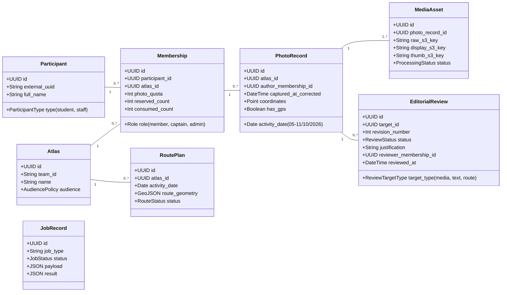

# Fronteiras de Domínio e Modelo Conceitual — Atlas Santos

Este documento detalha o modelo conceitual e o encapsulamento de responsabilidades entre os dez domínios de negócio do **Atlas Santos**.

---

## 1. Entidades Principais e Localização de Domínio

Para evitar modelo anêmico ou cruzamento indiscriminado de dados, cada entidade é de propriedade exclusiva de um domínio:

---

## 2. Dicionário de Domínios e Serviços Públicos

### 2.1 `identity`
- **Entidades proprietárias**: `UserAccount`, `SessionRecord`, `InvitationToken`.
- **Interface pública**:
  - `authenticate_session(cookie: str) -> Optional[AuthenticatedUser]`
  - `create_invitation(participant_id: UUID) -> str`
  - `revoke_session(session_id: str) -> None`

### 2.2 `organization`
- **Entidades proprietárias**: `Team`, `Atlas`, `Membership`.
- **Interface pública**:
  - `reserve_quota(membership_id: UUID) -> bool` (atômico no PostgreSQL)
  - `release_quota_reservation(membership_id: UUID) -> None`
  - `finalize_quota_consumption(membership_id: UUID) -> None`
  - `get_user_memberships(participant_id: UUID) -> List[Membership]`

### 2.3 `contributions`
- **Entidades proprietárias**: `PhotoRecord`, `ReflectionEntry`, `ActivityDay`.
- **Interface pública**:
  - `create_draft_record(membership_id: UUID, date: date) -> PhotoRecord`
  - `update_capture_metadata(photo_id: UUID, captured_at: datetime, coords: Optional[Point]) -> None`
  - `submit_reflection(photo_id: UUID, text: str, theme_id: Optional[str]) -> None`

### 2.4 `media`
- **Entidades proprietárias**: `MediaAsset`, `UploadReservation`.
- **Interface pública**:
  - `initiate_upload(membership_id: UUID, filename: str, mime_type: str) -> UploadTicket`
  - `confirm_upload(reservation_id: UUID) -> JobRecord`
  - `get_display_url(media_id: UUID) -> str` (URL pré-assinada de leitura privada)

### 2.5 `curation`
- **Entidades proprietárias**: `EditorialReview`, `ReviewAuditLog`.
- **Interface pública**:
  - `get_captain_review_queue(atlas_id: UUID) -> List[PendingReviewItem]`
  - `submit_media_review(review_id: UUID, decision: Decision, reason: Optional[str]) -> None`
  - `submit_text_review(review_id: UUID, decision: Decision, reason: Optional[str]) -> None`

### 2.6 `routes`
- **Entidades proprietárias**: `RoutePlan`, `RouteWaypoint`, `RouteSegment`.
- **Interface pública**:
  - `request_route_reconstruction(atlas_id: UUID, day: date) -> JobRecord`
  - `adjust_route_segments(route_id: UUID, segments: List[SegmentEdit]) -> None`
  - `approve_route(route_id: UUID, captain_id: UUID) -> None`

### 2.7 `ai`
- **Entidades proprietárias**: `AIDescriptionProposal`, `AICostLog`.
- **Interface pública**:
  - `enqueue_description_analysis(photo_id: UUID) -> JobRecord`
  - `get_proposals_for_photo(photo_id: UUID) -> List[AIDescriptionProposal]`
  - `record_token_usage(model: str, prompt_tokens: int, completion_tokens: int) -> None`

### 2.8 `publication`
- **Entidades proprietárias**: `AudienceRule`, `ContentTakedown`.
- **Interface pública**:
  - `is_record_eligible_for_viewer(photo_id: UUID, viewer: Optional[User]) -> bool`
  - `request_takedown(target_id: UUID, reason: str, actor_id: UUID) -> None`
  - `invalidate_dependent_artifacts(photo_id: UUID) -> None`

### 2.9 `exports`
- **Entidades proprietárias**: `ExportTask`, `ExportArtifact`.
- **Interface pública**:
  - `request_export(atlas_id: UUID, day: Optional[date], format: ExportFormat) -> JobRecord`
  - `get_export_download(export_id: UUID, user: User) -> str`

### 2.10 `administration`
- **Entidades proprietárias**: `BatchImportRecord`, `ReconciliationIssue`, `SystemAuditTrail`.
- **Interface pública**:
  - `preview_if_arbitra_import(payload: dict) -> ImportPreviewResult`
  - `commit_if_arbitra_import(batch_id: UUID) -> ImportSummary`
  - `query_audit_logs(filter_params: AuditFilter) -> List[AuditEntry]`

