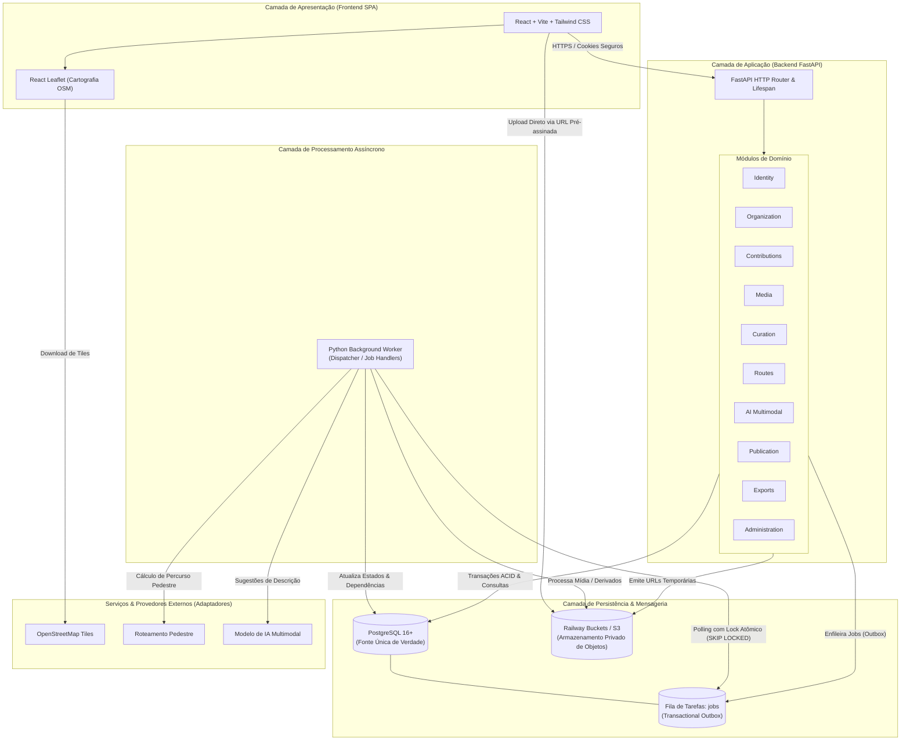
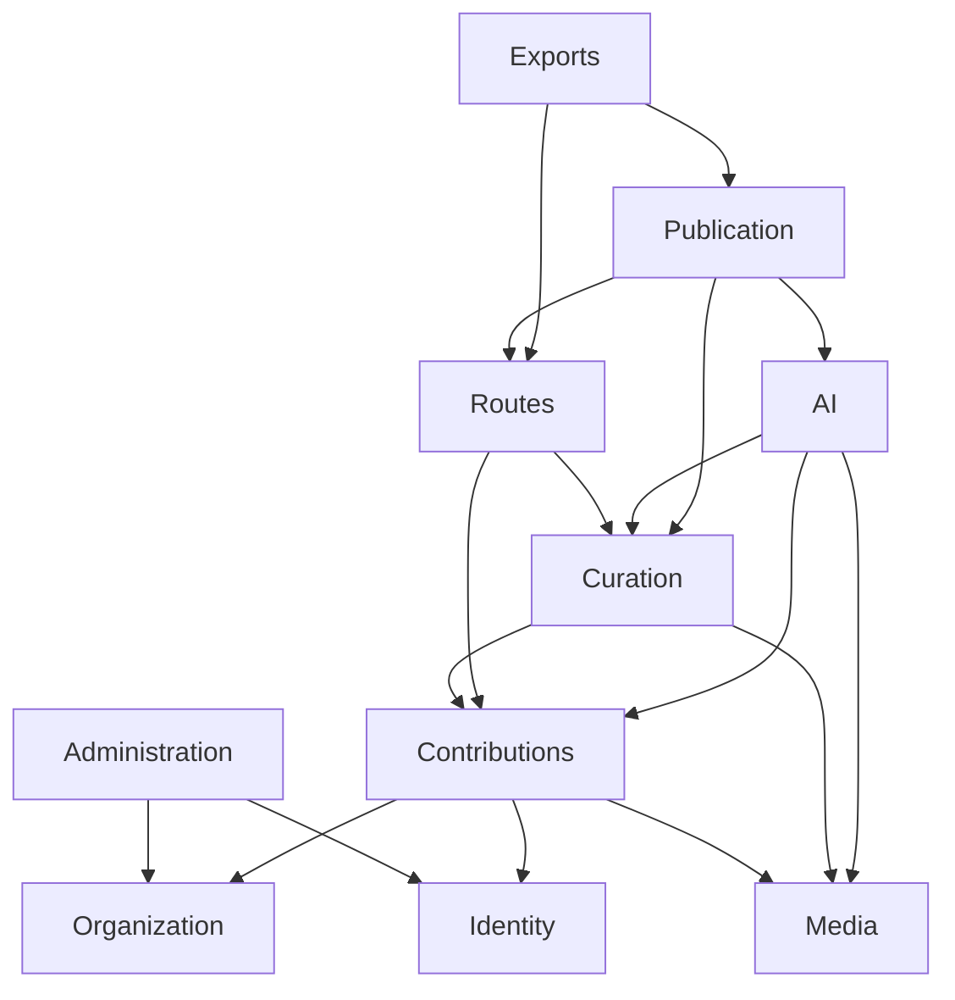

# Visão Geral da Arquitetura — Atlas Santos

Este documento apresenta a fundamentação arquitetural do **Atlas Santos**, sistema de cartografia colaborativa desenvolvido para organizar fotografias, memórias, percursos e reflexões do Estudo do Meio em Santos (viagem realizada de 05 a 11/10/2026), abrangendo 95 participantes (83 estudantes e 12 servidores).

---

## 1. Estilo Arquitetural: Monólito Modular

Conforme definido no [ADR-0001](../decisions/ADR-0001-modular-monolith-and-worker.md), o Atlas Santos adota o estilo **Monólito Modular** com processo de **Background Worker independente**, compartilhando o mesmo repositório e base de código de domínios.

### Justificativa de Engenharia
- **Adequação à Escala**: O sistema atende 95 pessoas com capacidade de referência de 1.900 fotos (20 fotos por participante em seu atlas autorizado). Não há exigência de milhares de requisições por segundo.
- **Complexidade Transacional vs. Distribuída**: A complexidade do sistema reside na consistência rigorosa entre arquivos, metadados, cotas atômicas, revisões editoriais independentes, autorizações de audiência e invalidação em cascata. Um desenho distribuído em microsserviços introduziria latência de rede, transações distribuídas (2PC/Saga) e falhas parciais sem agregar valor.
- **Eficiência para Equipe de Cinco Integrantes**: O monólito modular estabelece fronteiras estritas de domínio, permitindo que cinco desenvolvedores atuem em módulos distintos simultaneamente sem overhead de infraestrutura distribuída.

---

## 2. Diagrama Arquitetural do Sistema



---

## 3. Componentes e Responsabilidades

### 3.1 Camada de Apresentação (Frontend)
- **Tecnologias**: React 18, Vite, Tailwind CSS, React Leaflet.
- **Responsabilidade**: Renderização de interfaces acessíveis (responsivas até 360px sem rolagem horizontal — RNF-04), mapa interativo, galeria de fotografias, painel do participante com acompanhamento de cota e mesa de curadoria do capitão.
- **Segurança**: Nenhuma lógica de autorização confidencial ou credencial reside no cliente; toda ação privada é autenticada por cookies HTTP-only seguros validados no servidor.

### 3.2 Camada de Aplicação (Backend FastAPI)
- **Tecnologias**: Python 3.11+, FastAPI, Pydantic v2, SQLAlchemy 2.0.
- **Responsabilidade**: Fornecimento da API RESTful com documentação OpenAPI automática. Validação de contratos, aplicação de regras de autorização em duas dimensões (permissão do ator e elegibilidade do conteúdo), gestão de sessões e transações de negócio.
- **Routers Magros**: Os endpoints atuam exclusivamente como adaptadores de entrada HTTP, delegando operações aos serviços dos módulos de domínio.

### 3.3 Camada de Processamento Assíncrono (Python Worker)
- **Tecnologias**: Python puro com AsyncIO e SQLAlchemy, compartilhando a base de modelos do backend.
- **Responsabilidade**: Processamento pesado fora do ciclo de requisição HTTP:
  - Extração de metadados EXIF e geração de derivados gráficos sem GPS (miniatura de 480px e exibição de 2048px).
  - Chamada a provedores de IA multimodal para gerar alternativas de descrição.
  - Reconstrução de percursos pedestres com tratamento de quebras e lacunas.
  - Renderização de cadernos de memórias (PDF) e painéis visuais (PNG).
  - Reconciliação periódica de arquivos órfãos no armazenamento de objetos.

### 3.4 Camada de Persistência e Mensageria
- **PostgreSQL**: Fonte única de verdade de estados, vínculos, cotas, auditorias e dependências entre revisões.
- **Transactional Outbox (`jobs`)**: Tabela relacional de tarefas gerenciada transacionalmente junto com os registros de negócio. Garante que tarefas não sejam perdidas se o worker for reiniciado (RNF-06).
- **Railway Buckets (S3-compatible)**: Armazenamento privado de objetos binários (fotografias originais e derivadas). Nenhum arquivo é persistido no disco local dos servidores.

---

## 4. Domínios de Negócio e Regras de Dependência

A arquitetura define 10 domínios com fronteiras de encapsulamento rígidas:



### Regras de Acoplamento entre Módulos:
1. **Unidirecionalidade**: Dependências cíclicas entre módulos são terminantemente proibidas.
2. **Isolamento de Persistência**: Um módulo jamais realiza queries em tabelas de outro módulo. O acesso ocorre via serviços públicos do domínio.
3. **Imutabilidade e Revisões**: Entidades sujeitas a curadoria e publicação utilizam versionamento explícito de revisões. Alterar uma foto ou reflexão gera nova revisão e invalida artefatos derivados (RNF-15).

---

## 5. Processamento Assíncrono e Resiliência (RNF-06, RNF-14)

O padrão **Transactional Outbox** opera através da tabela `jobs`:
1. Quando uma ação requer trabalho assíncrono (ex: finalização de upload de foto), o endpoint do domínio grava o registro e insere uma linha correspondente na tabela `jobs` dentro da **mesma transação PostgreSQL**.
2. O Worker realiza polling concorrente seguro utilizando:
   ```sql
   SELECT * FROM jobs
   WHERE status = 'queued'
   ORDER BY priority DESC, created_at ASC
   LIMIT 1
   FOR UPDATE SKIP LOCKED;
   ```
3. O worker executa o handler registrado com controle de retentativas (`retry_count < max_retries`), backoff e registro de erros.
4. Reinicializações do contêiner do worker não causam perda de tarefas nem corrupção de cotas.

---

## 6. Modelo de Segurança e Privacidade (RNF-01, RNF-02, RNF-07)

1. **Autorização em Duas Dimensões**:
   - *Dimensão 1 (Ator)*: O que o usuário autenticado tem permissão para fazer (ex: estudante, capitão do atlas, administrador).
   - *Dimensão 2 (Elegibilidade do Conteúdo)*: Se o registro atende a todas as condições para ser exibido à audiência solicitada (ativo, revisão aprovada pelo capitão, política de audiência autorizada, ausência de solicitação de retirada).
2. **Privacidade de Dados de Menores e Participantes**:
   - Dados de acesso privados não são utilizados como autoria pública.
   - Metadados sensíveis (coordenadas GPS brutas no cabeçalho EXIF) são estritamente purgados das versões de exibição e miniatura.
   - Chamadas a provedores de IA utilizam apenas a imagem sem EXIF e a reflexão aprovada.
3. **Uploads Seguros e Isolamento**:
   - Upload direto cliente-bucket por URLs temporárias pré-assinadas com validade de 10 minutos.
   - A URL temporária possui restrição de chave e tamanho máximo de arquivo (15 MB).
   - Finalização com verificação atômica de integridade impede que chaves existentes sejam sobrescritas.

