# Máquina de Estados e Dimensões de Ciclo de Vida — Atlas Santos

Uma das diretrizes críticas de modelagem do Atlas Santos (Seção 6.1 da Especificação de Requisitos) é a **separação estrita entre estados concorrentes**. 

> [!CAUTION]
> **Anti-pattern proibido**: Condensar o ciclo de vida da fotografia em um único campo genérico `status` (ex: "em_andamento" ou "publicado"). Isso gera inconsistências graves, pois uma foto pode estar com o arquivo pronto, mas com a legenda rejeitada, a mídia aprovada e a audiência temporariamente restrita.

---

## 1. As Seis Dimensões de Estados Independentes

O sistema mantém e audita separadamente seis ciclos de vida:

```mermaid
stateDiagram-v2
    direction TB

    state "Dimensão 1: Transferência e Processamento" as D1 {
        [*] --> Reservado: Solicitação de upload
        Reservado --> Enviando: URL pré-assinada emitida
        Enviando --> Processando: Finalização confirmada
        Processando --> Pronto: Miniatura & EXIF gerados
        Processando --> Falhou: Erro no formato / corrupção
        Reservado --> Expirou: Timeout de 30 min (RN-04)
        Enviando --> Expirou: Timeout de upload
    }

    state "Dimensão 2: Revisão Editorial de Mídia" as D2 {
        [*] --> Pendente: Foto processada
        Pendente --> Aprovado: Capitão aprova foto
        Pendente --> AjustesSolicitados: Capitão pede correção
        AjustesSolicitados --> Pendente: Autor corrige e reenvia
        Pendente --> Rejeitado: Capitão rejeita
    }

    state "Dimensão 3: Textos (Legenda, IA e Reflexão)" as D3 {
        [*] --> Ausente: Foto sem texto
        Ausente --> Rascunho: Participante redige/IA sugere
        Rascunho --> PendenteTexto: Submetido para revisão
        PendenteTexto --> AprovadoTexto: Capitão aprova texto
        PendenteTexto --> AjustesTexto: Capitão pede ajuste
        AjustesTexto --> PendenteTexto: Reenvio de texto
        PendenteTexto --> RejeitadoTexto: Capitão rejeita texto
    }

    state "Dimensão 4: Percurso Reconstruído" as D4 {
        [*] --> SemDadosSuficientes: Menos de 2 pontos
        SemDadosSuficientes --> Proposto: Roteamento calculou ruas
        Proposto --> EmRevisao: Capitão ajustando trechos
        EmRevisao --> AprovadoPercurso: Capitão aprovou
        AprovadoPercurso --> Desatualizado: Foto do trajeto foi alterada/excluída
        Proposto --> FalhouRoteamento: Indisponibilidade de roteador
    }

    state "Dimensão 5: Disponibilização e Audiência" as D5 {
        [*] --> Restrito: Aguardando aprovação
        Restrito --> AtivoPermitido: Aprovado + Audiência configurada
        AtivoPermitido --> Suspenso: Solicitação de moderação/privacidade
        Suspenso --> AtivoPermitido: Reintegração confirmada
        AtivoPermitido --> Excluido: Retirada definitiva
    }

    state "Dimensão 6: Tarefa de Exportação" as D6 {
        [*] --> NaFila: Pedido registrado
        NaFila --> ProcessandoExp: Worker assumiu
        ProcessandoExp --> Concluida: PDF/PNG/HTML/GeoJSON gerado
        ProcessandoExp --> FalhouExp: Erro de renderização
        Concluida --> Expirada: Após 7 dias
        Concluida --> Invalidada: Fonte sofreu alteração (RN-16)
    }
```

---

## 2. Matriz de Estados e Efeitos de Negócio

| Dimensão | Estados Mínimos | Efeito no Sistema |
| :--- | :--- | :--- |
| **1. Transferência e Processamento** | `reservado`, `enviando`, `processando`, `pronto`, `falhou`, `expirou` | Arquivo incompleto, corrompido ou expirado jamais é liberado para visualização ou curadoria. |
| **2. Revisão de Mídia e Metadados** | `pendente`, `ajustes_solicitados`, `aprovado`, `rejeitado` | Capitão decide sobre a imagem e metadados. Apenas imagens aprovadas podem ser disponibilizadas. |
| **3. Legenda, Descrição e Reflexão** | `ausente`, `rascunho`, `pendente`, `ajustes_solicitados`, `aprovado`, `rejeitado` | Ausência ou pendência de texto **não impede** a aprovação da mídia da foto (RN-08). Textos não aprovados são omitidos da exibição pública. |
| **4. Percurso Reconstruído** | `sem_dados_suficientes`, `proposto`, `em_revisao`, `aprovado`, `desatualizado`, `falhou` | Apenas o percurso aprovado pelo capitão é exibido no mapa como oficial. Falhas no roteamento mantêm os marcadores pontuais visíveis. |
| **5. Disponibilização e Audiência** | `ativo_permitido`, `restrito`, `suspenso`, `excluido` | A aprovação do capitão é condição necessária, mas não suficiente: a visualização exige conformidade com as permissões de audiência e ausência de suspensão (RN-07, RF-30). |
| **6. Exportações** | `na_fila`, `processando`, `concluida`, `falhou`, `expirada`, `invalidada` | Arquivos compilados têm validade e vinculam-se aos IDs exatos das revisões. Alterações nas fontes invalidam os arquivos em cache (RN-16, RNF-15). |

---

## 3. Regras de Invalidação em Cascata (RN-16, RNF-15)

Quando uma fotografia é **alterada**, **suspensa** ou **excluída**:
1. Se a foto fazia parte de um percurso aprovado: o percurso transita para o estado `desatualizado` e sinaliza pendência ao capitão.
2. Se a foto possuía descrição gerada por IA: a descrição transita para `desatualizada`, exigindo nova revisão.
3. Se a foto constava em cadernos PDF ou painéis PNG hospedados: a exportação é imediatamente marcada como `invalidada` e o download público é bloqueado.

