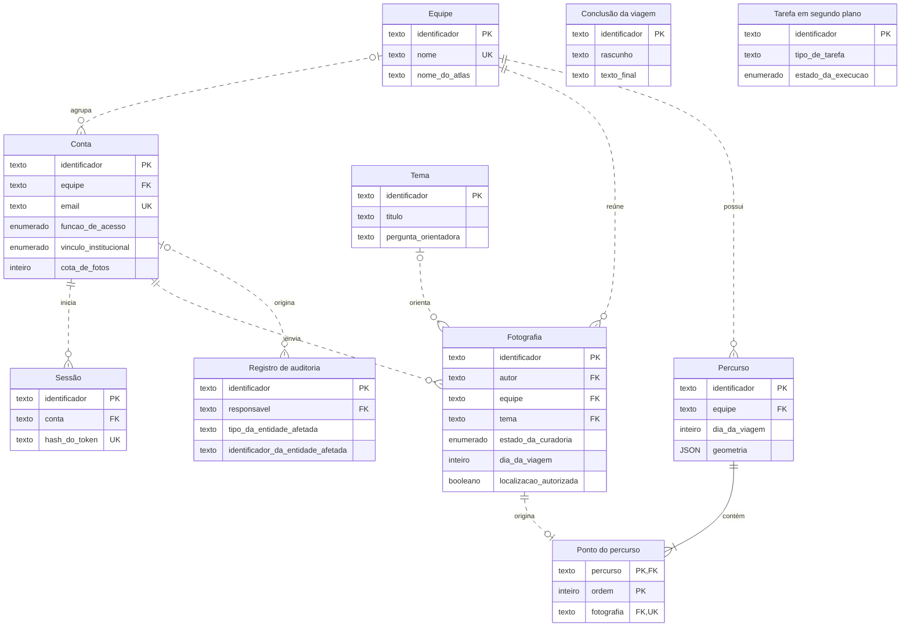

# Banco de dados do Atlas Santos

Cada equipe tem seu próprio atlas. No banco, a equipe dá nome ao atlas, a conta identifica quem enviou cada fotografia e a foto reúne a legenda, a reflexão e a decisão de curadoria. O percurso é um resultado calculado a partir dos registros da equipe em um dia da viagem.

Este documento descreve o esquema PostgreSQL.

## Diagrama entidade-relacionamento

`PK` identifica a chave primária, `FK` uma chave estrangeira e `UK` um valor único. O círculo indica participação opcional e a extremidade ramificada indica muitos registros. Os vínculos entre as nove tabelas do dicionário já constam nas migrações.

Uma foto pertence a **um autor e uma equipe** e pode ter **um tema**. A síntese em `trip_conclusions` é coletiva para a viagem. Tanto ela quanto a fila `jobs` são tabelas independentes no esquema atual. O par `entity_type` e `entity_id` identifica o alvo de uma ação de auditoria por convenção da aplicação.

### Como as fotografias formam o percurso

No modelo proposto, cada ponto do percurso vigente identifica a foto de origem e sua posição na sequência de captura. O par **percurso + ordem** identifica a posição. Uma foto participa de, no máximo, um percurso vigente, pois pertence a uma equipe e a um dia. Um percurso publicado exige pelo menos dois pontos válidos em locais distintos.

Por exemplo, se o percurso de uma equipe usa as fotos **A → B → C** e a foto **B** é retirada, o sistema invalida o traçado anterior e calcula o caminho a pé entre **A e C**. Durante o recálculo, o mapa e as exportações deixam de oferecer a geometria antiga. Se restar apenas **A**, mantém-se o marcador autorizado e retira-se a linha. Se nenhuma foto elegível restar, retiram-se também os marcadores daquele recorte.

O recálculo considera novamente todas as fotos aprovadas com localização autorizada da equipe naquele dia, inclusive quando uma foto entra, volta à revisão ou perde a autorização. Alterar a localização ou o horário pode mudar o caminho ou a ordem dos pontos. Se uma correção mudar o dia ou a equipe, os dois recortes precisam ser atualizados.

## Como os requisitos se traduzem em dados

### Acesso e equipes · RF001–RF004

O cadastro previsto reúne 83 estudantes e 12 servidores do IFSP Campus Araraquara. Esses números orientam o provisionamento. O vínculo institucional (`ESTUDANTE` ou `SERVIDOR`) é independente da função de acesso (`PARTICIPANTE`, `CAPITAO` ou `ADMINISTRACAO`). Assim, um servidor pode enviar fotos como participante. O título do atlas fica em `teams.atlas_name`.

O banco exige equipe para participantes e capitães. Um índice único parcial sobre `users.team_id`, aplicado à função `CAPITAO`, admite **no máximo um capitão por equipe**. A conferência do pré-cadastro deve identificar equipes ainda sem capitão. O login consulta o e-mail único e o hash da senha. Cada sessão tem um hash de token próprio, expiração e data de revogação. O acesso de uma sessão também depende de a conta continuar ativa (RNF005–RNF006).

### Acervo, reflexão e curadoria · RF009–RF022

A cota padrão de 20 fotos fica na configuração da aplicação e é registrada por pessoa em `users.photo_quota`. Com a cota padrão, o acervo previsto é de aproximadamente **1.900 fotos** (RNF001–RNF002). O envio associa a foto à equipe do autor. As duas FKs garantem a existência do autor e da equipe; a API precisa conferir o vínculo entre eles e respeitar a cota inclusive em envios simultâneos.

No PostgreSQL, a curadoria usa os valores `PENDING`, `APPROVED`, `REJECTED` e `REMOVED`. O levantamento prevê entrada na fila da equipe, aprovação automática no envio pelo próprio capitão, justificativa para rejeição e nova revisão após edição. A consulta da fila usa equipe e estado. A reflexão opcional fica na própria foto e acompanha sua revisão. O tema aponta para a pergunta orientadora de `themes`.

### Mapa e percursos · RF005–RF009 e RF026–RF028

A viagem ocorreu de 5 a 11 de outubro de 2026. O recorte de consulta é **equipe + dia da viagem**. `captured_at` registra o momento da foto; `created_at` registra seu cadastro. O percurso deve ordenar os registros pelo momento da captura, considerar aprovação e localização autorizada e conectar os pontos por caminhos prováveis a pé. Com um único ponto válido, o mapa ainda pode exibir o marcador.

`routes.geometry` armazena a geometria em JSON; `provider_name` identifica a origem do cálculo e a distância é expressa em metros. O GeoJSON usa a ordem **longitude, latitude**. O protótipo do backend conecta pontos por segmentos retos. O roteamento a pé e a atualização dos trajetos após mudanças nas fotos ainda exigem integração (RNF011, RNF023–RNF024).

### IA, síntese e exportação · RF023–RF025 e RF029–RF036

A descrição sugerida para uma imagem cabe em `photos.ai_description`. A análise prevista usa a imagem e, quando disponível, sua reflexão aprovada. Já `trip_conclusions` guarda rascunho, texto final e estado da síntese da viagem, inspirada em *Sonho Manifesto* e sujeita à revisão da administração. São dois fluxos de revisão com responsáveis diferentes.

PDF, PNG e GeoJSON são saídas calculadas sobre o recorte autorizado. Para uma exportação com fotos, a consulta deve recuperar autoria e textos aprovados; para um mapa, deve filtrar também a permissão de exibir localização. O cadastro do percurso e a aprovação da foto, por si sós, não autorizam divulgar coordenadas precisas ou EXIF privado.

### Arquivos, processamento e recuperação · RNF003, RNF007–RNF008, RNF011–RNF013 e RNF017–RNF025

`original_key` e `derived_key` identificam objetos de armazenamento. A arquitetura prevê original privado e cópia de exibição sem EXIF, em Railway Buckets compatíveis com S3. O protótipo de upload ainda mantém arquivos em memória. Uma restauração completa precisa recuperar banco e objetos correspondentes e reaplicar retiradas de conteúdo antes de liberar acesso.

`jobs` registra entrada, resultado, estado, tentativas e erro de trabalhos assíncronos. A fila admite `QUEUED`, `PROCESSING`, `COMPLETED`, `FAILED` e `EXPIRED`. Já `audit_logs` registra ações sobre entidades, com autor opcional para eventos de sistema. Dados de sessão, credenciais e EXIF bruto devem ficar fora de payloads de exportação e detalhes de auditoria.